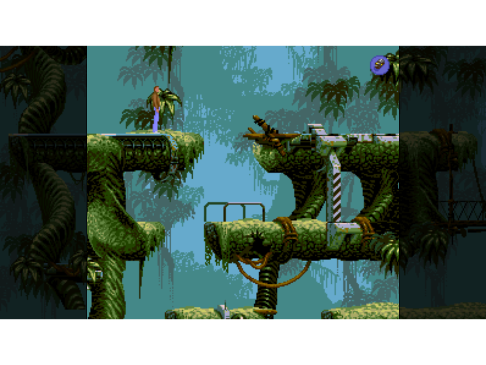
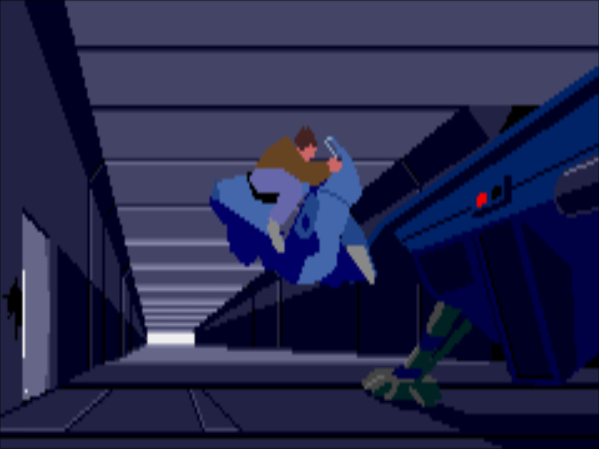
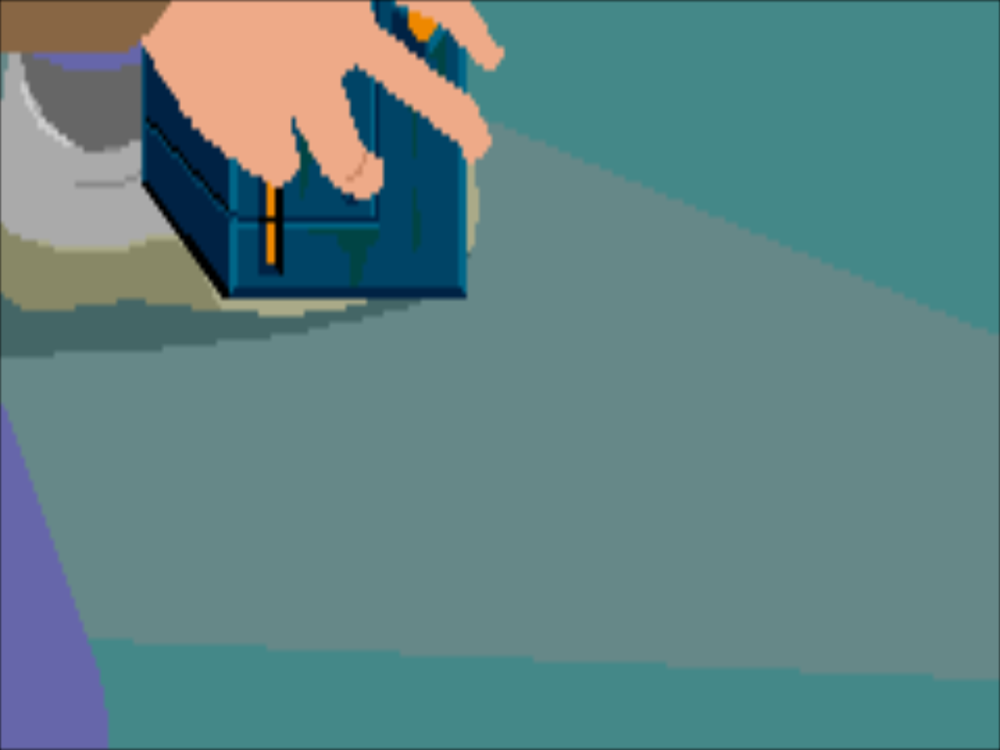

# Flashback for R36UX

> **Pre-release:** This repository currently contains source code and PortMaster configuration, but no prebuilt executable or runtime libraries. Licensing review and release packaging are still in progress.

An enhanced adaptation of the REminiscence engine for the R36 Ultra X handheld.

## About

Flashback for R36UX is a community modification of REminiscence, the open-source reimplementation of the engine used by Flashback (1992).

This adaptation targets the R36 Ultra X handheld with a 4.5-inch, 1024x768 display and ArkOS4Clone.

## Features

- Fullscreen cinematic sequences optimized for the R36 Ultra X display.
- Restored cinematic subtitles displayed in a fixed black overlay, without resizing the cinematic.
- Improved scaling for special cinematics, including the Stone pickup animation.
- Restored musical cues for item pickup sequences.
- Sega CD voice support through the original VOICE.VCE file.
- Working FN button to exit the game.
- PortMaster launcher and controller integration.
- Preserved gameplay proportions and adjacent-room widescreen rendering.

## Requirements

- R36 Ultra X handheld
- Compatible Linux firmware with PortMaster support
- Original Flashback game data files
- Optional Sega CD VOICE.VCE file for spoken dialogue
- Compatible music modules for the soundtrack

Commercial game assets are not included.

## Installation

A public prebuilt installer is not yet available.
This repository provides the source code, PortMaster launcher
and configuration files, but excludes the ARM64 executable,
runtime libraries and commercial Flashback assets.

To prepare an installation from source:

1. Build the ARM64 executable `rs` using `docs/BUILD.md`.
2. Copy the PortMaster launcher and configuration files to your `ports` directory.
3. Install the compiled executable as `ports/reminiscence/fb`.
4. Supply compatible ARM64 runtime dependencies, including libmodplug.
5. Place legally obtained Flashback game files in `ports/reminiscence/gamedata`.
6. Place compatible music modules in `ports/reminiscence/music`.
7. Launch `Flashback for R36UX` from the Ports menu.

See `docs/INSTALLATION.md` for additional details.

## Screenshots

### Gameplay

### Cinematics

### Special Animations

## Build

The included source was cross-compiled for Linux ARM64 using Docker and the dockcross Linux ARM64 toolchain.

The build requires SDL2, libmodplug and zlib development libraries compatible with the target system.

## Credits

- Gregory Montoir — original REminiscence engine.
  https://github.com/cyxx/REminiscence
- Alex Chermenin — REinforced, a related enhanced REminiscence project.
  https://github.com/chermenin/REminiscence
- Jetup13 — REminiscence-oga, a related adaptation for Linux handhelds.
  https://github.com/Jetup13/REminiscence-oga

Flashback and its original game assets belong to their respective rights holders.

## Status

Version 1.0 — source release candidate.

The final private ARM64 build has been tested on the
R36 Ultra X running ArkOS4Clone with PortMaster.

Fullscreen cinematics, subtitle overlays, music,
Sega CD voices and FN-button support have been tested.

A public binary installer has not yet been released.
Full regression testing of every cinematic is still pending.

The specific Voyage scaling branch has not been
independently instrumented or verified.

## License

The modified REminiscence engine source is presented
under GNU GPLv3.

See `LICENSE` and `docs/LICENSING.md` for license details,
attribution and the status of upstream licensing evidence.

Original commercial Flashback game assets are not included.
Third-party components retain their respective licenses.
